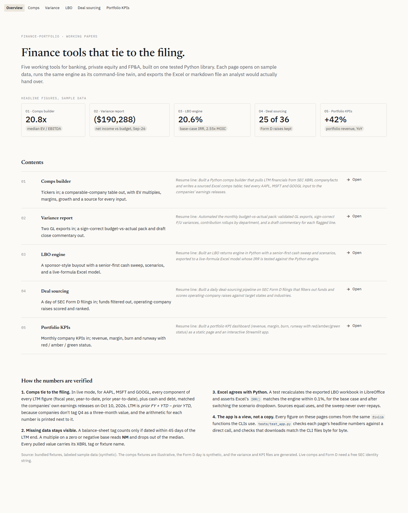

# finance-portfolio

Five finance automation projects built on one shared library. Each project ends in a working tool and a one-command demo that runs on fixtures with no API keys.

| # | Project | Status | Run |
| --- | --- | --- | --- |
| 1 | [Comps Builder](projects/comps/README.md) — SEC XBRL + market data → Excel comps table | **Working** | `make demo-comps` |
| 2 | [Variance Report Generator](projects/variance/README.md) — actuals vs budget → Excel pack + commentary | **Working** | `make demo-variance` |
| 3 | [LBO Returns Engine](projects/lbo/README.md) — Python LBO → live-formula Excel with scenarios | **Working** | `make demo-lbo` |
| 4 | [Deal Sourcing Pipeline](projects/sourcing/README.md) — daily SEC Form D → scored digest | **Working** | `make demo-sourcing` |
| 5 | [Portfolio KPI Dashboard](projects/dashboard/README.md) — monthly KPIs → hosted page | **Working** | `make demo-dashboard` |

## Try it

**Live app: [finance-portfolio-dnaltroc.streamlit.app](https://finance-portfolio-dnaltroc.streamlit.app/)** (sample data; it may take 30 seconds to wake up).



Every tool also runs as a Streamlit app: five pages that open on sample data, run the same engines, and download the same files. See [app/README.md](app/README.md) for a tour with screenshots.

**Locally**

```bash
pip install -e ".[app]"
streamlit run app/Home.py
```

**On Streamlit Community Cloud (free)**

1. Push this repo to GitHub.
2. At [share.streamlit.io](https://share.streamlit.io), choose **Create app**, then pick the repo and branch, and set the main file path to `app/Home.py`.
3. Under **Advanced settings**, pick Python 3.12. Under **Secrets**, add `SEC_IDENTITY = "Your Name you@example.com"` to enable Live mode. Without it, the app runs on labeled sample data.
4. Deploy. Cloud installs `requirements.txt` from the repo root.

## Setup

```bash
pip install -e ".[dev]"          # core + pytest/ruff
pip install -e ".[live]"         # yfinance price fallback for live comps
cp .env.example .env             # add SEC_IDENTITY and FINNHUB_KEY
make test                        # all tests run offline on fixtures (Windows: $env:FINLIB_OFFLINE="1"; pytest -q)
```

## Layout

```
finlib/
  providers/     edgar.py (SEC companyfacts API), market.py (Finnhub → yfinance → manual), formd.py (SEC Form D)
  models/        ratios, variance, lbo, sourcing, kpi — pure math, no I/O
  excel_writer/  styles.py, tables.py — house style, openpyxl
  store/         cache.py — SQLite JSON cache so demos never hit a rate limit twice
projects/        one package per project, each with cli.py and a README
app/             Streamlit app: Home.py + pages/, a view over finlib (streamlit run app/Home.py)
tests/           pytest; fixtures in tests/fixtures/; test_app.py drives every page with AppTest
```

Every provider honors `FINLIB_OFFLINE=1` and reads from `tests/fixtures/` instead of the network. That is how CI runs and how demos run without keys.

## Conventions

- Hardcoded inputs are blue in every workbook; computed cells are black.
- Multiples on a zero or negative base show `NM` and are excluded from medians.
- Every pulled number carries its source (XBRL tag, API, or fixture) on the Inputs sheet.
