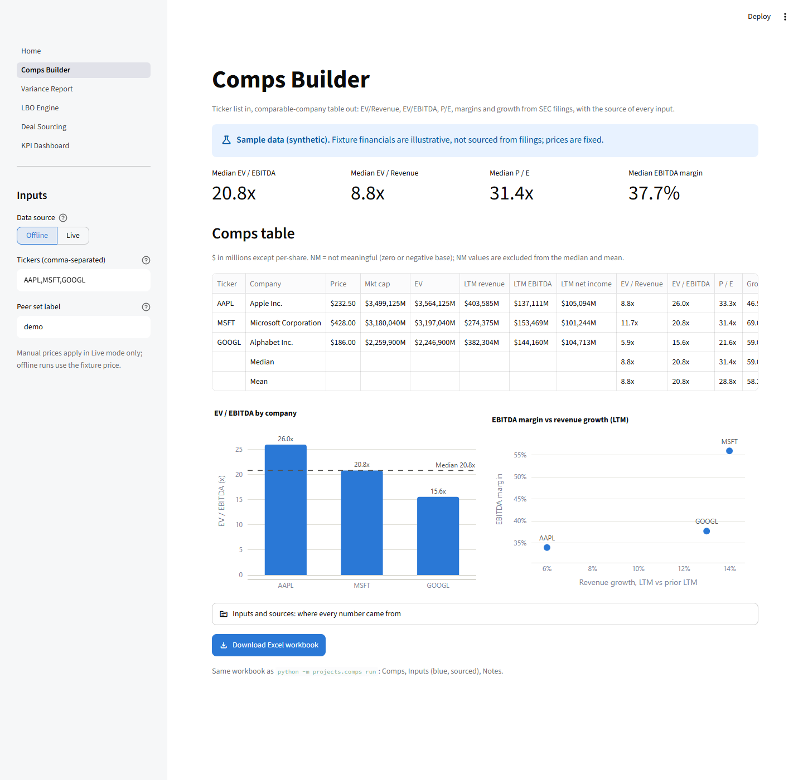
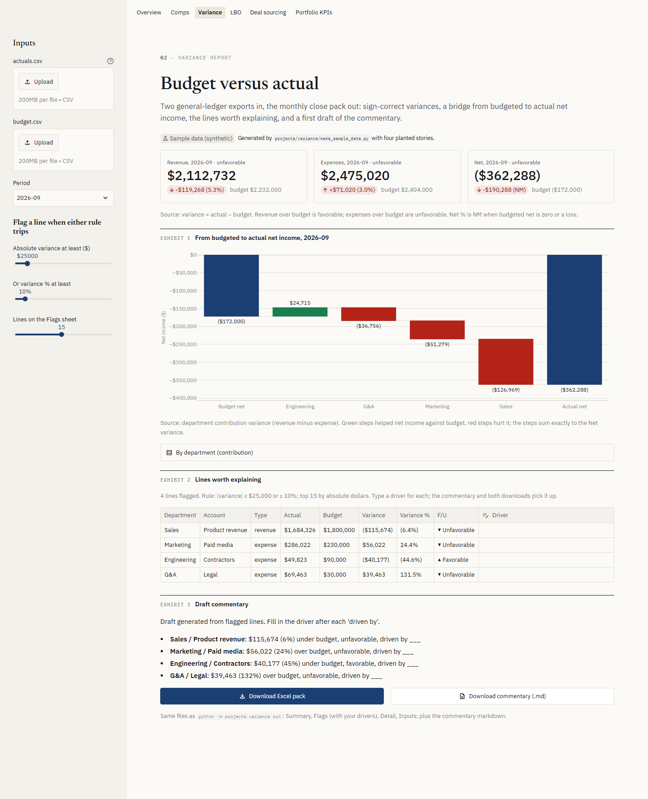
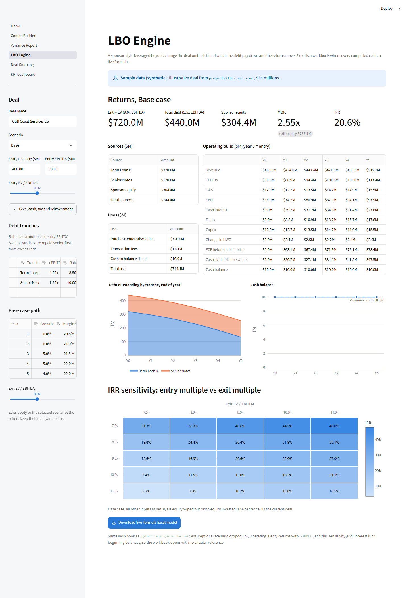
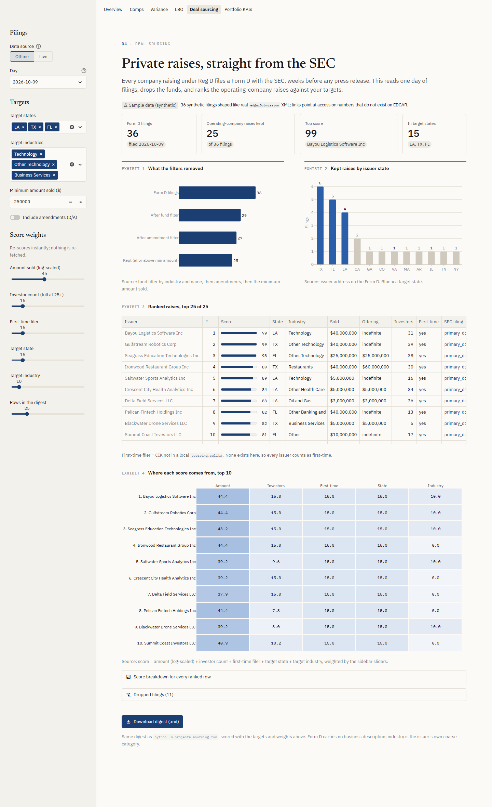
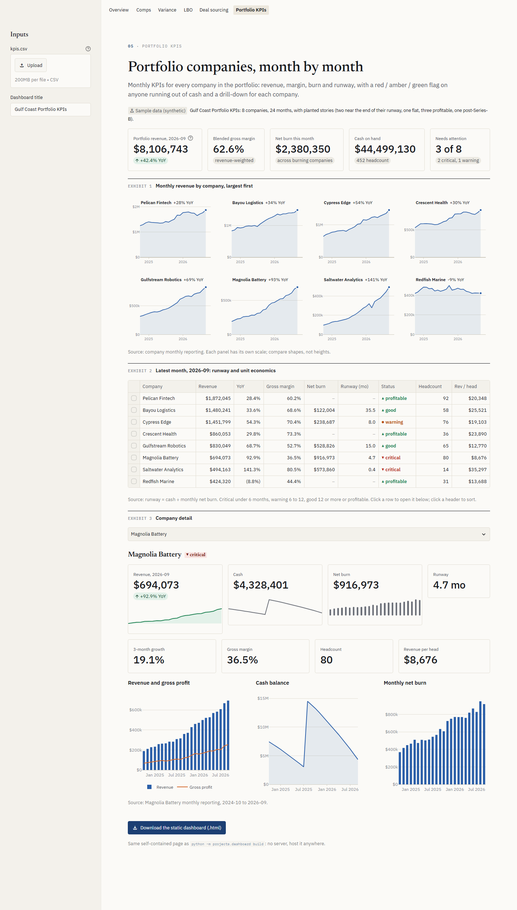
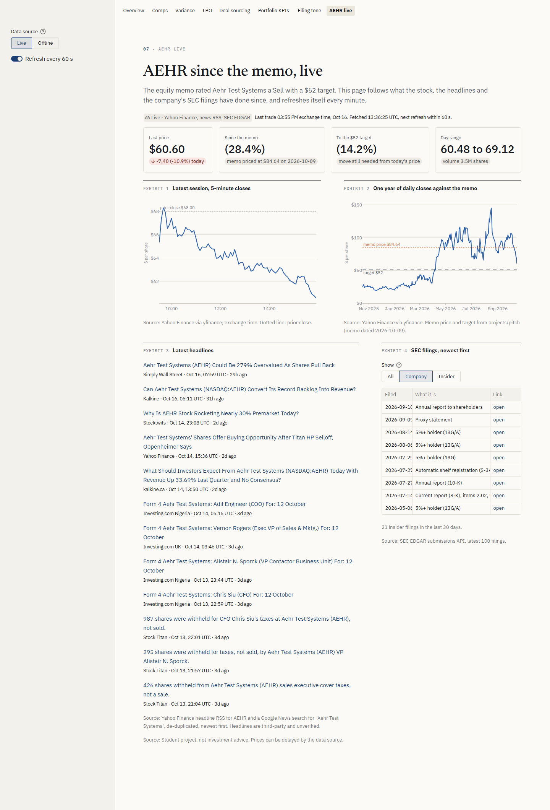

# finance-portfolio app

A Streamlit front end for the five tools. Every page opens on sample data, calls the same `finlib` functions and project builders as the CLIs, and downloads the same Excel or markdown file. The app is a view: it formats numbers, it never computes them.

```bash
pip install -e ".[app]"
streamlit run app/Home.py
```

## Pages

### Overview
A masthead, one headline figure from each tool (computed live from the same builders), a numbered contents list with each project's resume line, and how the numbers are verified. Navigation sits across the top, and each page keeps its inputs in the sidebar.


### Comps Builder
Tickers in (default AAPL, MSFT, GOOGL), Offline or Live. Shows median multiples, the comps table with Median and Mean rows, EV/EBITDA by company against the median, EBITDA margin against revenue growth, and an **Inputs and sources** table that lists every pulled value with its XBRL tag and LTM arithmetic. Manual prices apply in Live mode only, because offline runs always use the fixture price.



### Variance Report
Upload `actuals.csv` and `budget.csv` or use the sample. Pick a period and set the flag thresholds. Shows Revenue / Expenses / Net with favorable / unfavorable badges and a bridge from budgeted to actual net by department. The flagged lines sit in an editable table: type a driver and the commentary and both downloads pick it up.



### LBO Engine
Every `deal.yaml` input is a sidebar control: tranches and the scenario path are editable tables, and multiples are sliders. Shows the returns tile, sources and uses, the operating build, debt paydown by tranche, cash against the minimum (red band where it falls short), and an IRR heatmap of entry multiple against exit multiple. If debt exceeds the purchase price, the page shows **n/a** in place of a negative MOIC. The download is the live-formula workbook.



### Deal Sourcing
One day of SEC Form D filings, Offline (the synthetic fixture day) or Live (any weekday). Target states, industries and weight sliders re-score instantly without re-fetching. Shows the filter funnel, kept raises by state, the ranked table with links to each filing, a heatmap of where each top score comes from, and a score breakdown per row. The download is the markdown digest.



### KPI Dashboard
Upload `kpis.csv` or use the sample. Shows portfolio tiles, revenue small multiples, a sortable red / amber / green runway table (click a row to drill down), and a per-company detail view. The download is the same static `index.html` that `python -m projects.dashboard build` writes.



### Filing Tone
Reads the committed snapshot of AEHR and its peers' latest 10-Ks, scored sentence by sentence by a DistilBERT model fine-tuned on Financial PhraseBank. Net tone by company for MD&A and risk factors, the three-model comparison table, and the driver sentences per filing. No torch in the app; refresh with `python -m projects.filing_tone snapshot`.

### AEHR live
Follows the stock since the equity memo was priced. Last price and day move, the move since the memo and the move still needed to reach the $52 target, an intraday chart, a year of closes against the memo price and target, the latest headlines, and AEHR's SEC filings with an insider / company filter. Refreshes itself every 60 seconds. Prices from Yahoo Finance (yfinance), headlines from the Yahoo Finance and Google News RSS feeds, filings from SEC EDGAR; no API key needed beyond `SEC_IDENTITY`. If a feed fails, that section shows the synthetic fixture, labeled, with the error.



## Live data

Live comps and Live Form D call the SEC, which requires a contact string. Add it to `.env` locally or to **Secrets** on Streamlit Cloud:

```toml
SEC_IDENTITY = "Your Name you@example.com"
FINNHUB_KEY = ""   # optional; comps fall back to yfinance, then to manual prices
```

Without it the Live toggle shows a warning and the page stays on labeled sample data. Live Form D fetches a few hundred filings at 8 requests per second, so expect about a minute per day; results are cached for six hours. The page never writes `sourcing.sqlite`. If one exists locally, it is read to mark first-time filers.

## Conventions

- The visual system (research-note look: Newsreader, IBM Plex Sans and Mono, paper and ink, numbered exhibits with source lines) is defined in [DESIGN.md](../DESIGN.md) and `.streamlit/config.toml`.
- `$M` with parentheses for negatives on comps and LBO. Whole dollars on variance and KPIs, matching their Excel packs.
- Multiples as `12.3x` (MOIC `2.55x`), and `NM` wherever the engine returns `None`.
- One y-axis per chart. Blue is the primary series. Red, amber and green mean status only, and always carry a label or icon.

## Tests and screenshots

```bash
FINLIB_OFFLINE=1 pytest tests/test_app.py   # each page renders, headline numbers equal finlib, downloads non-empty
pip install -e ".[screenshots]" && python -m playwright install chromium
streamlit run app/Home.py --server.port 8599 &
python scripts/screenshots.py --url http://localhost:8599 --height 3200
```
